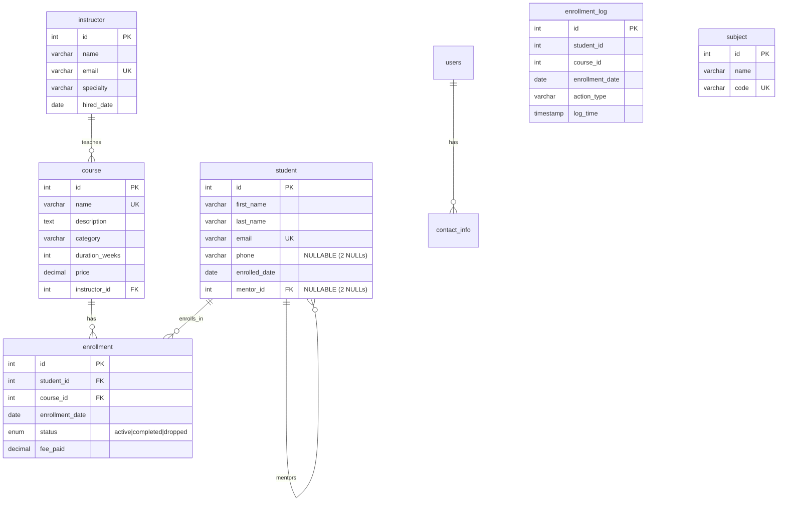

# Training Management DB (`training_db`) — Schema Reference

Use this reference when studying with ChatGPT or any AI agent (especially if Docker is not running) so every query, column name, and expected row count matches the real database in `db/init/01-schema.sql` and `db/init/02-seed.sql`.

---

## Entity-Relationship Diagram

---

## Seed Data Summary (Exact Row Counts)

### `instructor` (3 rows)
| id | name | specialty |
|---|---|---|
| 1 | Dr. Maya Lin | Data Science & ML |
| 2 | Carlos Rivera | Backend & Databases |
| 3 | Priya Nair | Cloud & Security |

### `course` (6 rows)
| id | name | category | price | instructor_id |
|---|---|---|---|---|
| 1 | Data Science | Data | 499.00 | 1 |
| 2 | Web Development | Engineering | 399.00 | 2 |
| 3 | Machine Learning | AI | 599.00 | 1 |
| 4 | Cybersecurity | Security | 449.00 | 3 |
| 5 | Cloud Computing | Cloud | 499.00 | 3 |
| 6 | Quantum Computing | Research | 699.00 | `NULL` *(0 enrollments)* |

### `subject` (5 rows)
`SQL Fundamentals` (`DB101`), `Data Science` (`DS101`), `Cloud Computing` (`CL101`), `Python Programming` (`PY101`), `Distributed Systems` (`CS301`).
*(Overlap with `course.name`: `Data Science`, `Cloud Computing` — 2 rows.)*

### `student` (8 rows)
| id | first_name | last_name | phone | mentor_id | enrollments |
|---|---|---|---|---|---|
| 1 | Alice | Johnson | 555-0101 | `NULL` | 3 |
| 2 | Bob | Smith | 555-0102 | 1 | 2 |
| 3 | Charlie | Brown | `NULL` | 1 | 2 |
| 4 | Diana | Prince | 555-0104 | 2 | 2 |
| 5 | Evan | Wright | 555-0105 | 2 | 2 |
| 6 | Fatima | Al-Zahra | `NULL` | `NULL` | 1 |
| 7 | George | Miller | 555-0107 | 4 | **0** |
| 8 | Hannah | Abbott | 555-0108 | 1 | **0** |

### `enrollment` (12 rows)
- Course 1 (`Data Science`): 3 enrollments (students 1, 2, 3)
- Course 2 (`Web Development`): 3 enrollments (students 1, 4, 5)
- Course 3 (`Machine Learning`): 2 enrollments (students 1, 4)
- Course 4 (`Cybersecurity`): 2 enrollments (student 2 `dropped` fee `0.00`, student 6 `active` fee `449.00`)
- Course 5 (`Cloud Computing`): 2 enrollments (students 3, 5)
- Course 6 (`Quantum Computing`): **0 enrollments**

### Other Tables
- `enrollment_log`: 12 rows (populated automatically by trigger `trg_after_enrollment_insert`)
- `users_unnormalized`: 2 rows (Alice has `'555-0101, 555-0199'` in one column)
- `users` (2 rows) + `contact_info` (3 rows): normalized 1NF/3NF version
- `activity_log`: 2,000 rows (`student_id` 1..8, `course_id` 1..5) for `EXPLAIN` & index labs
